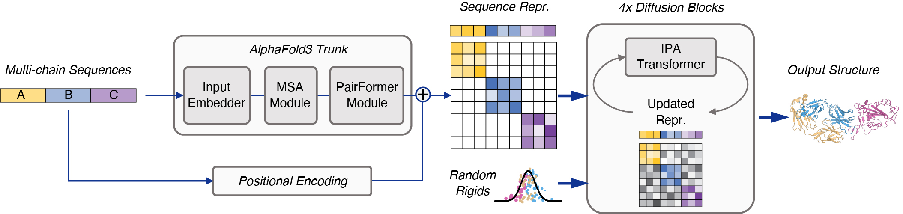

# DynoM
This is the code for "**Efficient exploration of conformational ensembles via protein interaction-informed deep learning**", a conditional diffusion model named **DynoM** natively designed for multi-chain inputs.



## Table of Contents

- [Installation](#installation)
  - [DynoM environment](#dynom-environment)
  - [Protenix environment](#protenix-environment)
- [Inference](#inference)
  - [Data Processing](#data-processing)
  - [Sampling](#sampling)
- [Training Data Preparation](#training-data-preparation)
- [Code Overview](#code-overview)
- [Citation](#citation)

## **Installation**

### DynoM environment

```bash
# clone project
git clone https://github.com/RPDGroup/DynoM.git
cd DynoM

# create conda virtual environment
conda env create -f ./environment/env.yml

# activate virtual environment
conda activate DynoM_env
```

### Protenix environment

Protenix generates MSAs and protein representations. Install the customized
version included in this repository in a separate environment. Use a Linux
machine with an NVIDIA GPU for representation generation.

Starting from the DynoM repository root:

```bash
# Create and activate the Protenix environment
conda create -n protenix_env python=3.10 pip -y
conda activate protenix_env

# Install PyTorch before installing Protenix and its dependencies
python -m pip install torch==2.3.1
cd data_processed/protenix
python -m pip install -e .

# Return to the repository root and the DynoM environment
cd ../..
conda activate DynoM_env
```

The editable installation installs the dependencies listed in Protenix's
`requirements.txt`. On first use, its runner downloads the encoder checkpoint
(`model_v0.2.0.pt`) and CCD cache, so network access is needed.

`Process_data.py` automatically calls `protenix_env` during data preparation.
For a different environment name, use `--protenix-env YOUR_ENV_NAME`.
To use an existing encoder checkpoint, pass
`--protenix-checkpoint /path/to/model_v0.2.0.pt`.

## **Inference**

### Data Processing

Activate `DynoM_env` and run the following command from the repository root.
Before the first run, install the customized Protenix environment using the
[installation steps above](#protenix-environment).

```bash
python Process_data.py \
    --input-fasta /path/to/input.fasta \
    --output-dir /path/to/prepared_data
```

`--input-fasta` accepts an RCSB-style FASTA file or a directory of FASTA files.
`--output-dir` must be a new or empty directory. The script calls `protenix_env`
automatically, so no manual environment switching or shell-script editing is
needed during processing.

The processing sequence is FASTA parsing, MSA search, Protenix input construction,
encoder representation generation, and sequence-index creation. The default
`--mode complex` preserves all chains in each target; use `--mode single` to
prepare chains independently.

After successful preparation with newly generated representations, the output contains:

| Output | Purpose |
| --- | --- |
| `dataset.pkl` | Sequence and chain metadata |
| `seqres_to_index.pkl` | Ordered sequence keys mapped to representation names |
| `AF3_repr/` | Single-residue and residue-pair features |
| `logs/` | MSA and encoder logs |
| `data_paths.json` | Input paths for `Predict.py` |
| `predict.sh` | Generated prediction command |

For an existing feature directory, pass `--repr-dir /path/to/AF3_repr` to skip
MSA search and encoder execution. The directory is referenced in place. Reused
features must match the input sequences, target names, chain order, and copy counts.

See [inference data preparation](data_processed/README_Inference.md) for environment
setup, input format, GPU options, and reuse of existing MSA or representation files.

### Sampling

After data preparation, start sampling with the generated command:

```bash
bash /path/to/prepared_data/predict.sh
```

This command uses `checkpoint/DynoM.ckpt`, batch size 10, and 1,000 samples per
target. Ensure the DynoM checkpoint is available at that path, or edit the
generated command to specify its location. The Protenix encoder checkpoint is
configured separately during data preparation.

Alternatively, provide the prepared inputs directly:

```bash
python Predict.py \
    --gen_dataset_test_gen_dataset /path/to/prepared_data/dataset.pkl \
    --alphafold3_cfg_seqres_to_index_path /path/to/prepared_data/seqres_to_index.pkl \
    --alphafold3_cfg_repr_data_root /path/to/prepared_data/AF3_repr \
    --gen_batch_size 10 \
    --gen_num_samples 1000 \
    --model_ckpt_path ./checkpoint/DynoM.ckpt \
    --output_dir ./output
```

To inspect inference options:

```bash
python Predict.py -h
```

| Argument | Required | Description |
| --- | --- | --- |
| `--gen_dataset_test_gen_dataset` | Yes | Metadata pickle containing the targets |
| `--alphafold3_cfg_seqres_to_index_path` | Yes | Sequence-to-representation lookup pickle |
| `--alphafold3_cfg_repr_data_root` | Yes | Directory containing cycle-10 representation files |
| `--gen_batch_size` | Yes | Number of items per sampling batch; the generated command uses 10 |
| `--gen_num_samples` | No | Samples per metadata row; default: 1,000 |
| `--model_ckpt_path` | Yes | DynoM model checkpoint |
| `--output_dir` | Yes | Output root; sampled PDBs are written under `test_gen/<PDB_ID>/` |

To sample using the prepared 8QB6 example supplied with this repository:

```bash
python Predict.py \
    --gen_dataset_test_gen_dataset ./example/input_8QB6.pkl \
    --alphafold3_cfg_seqres_to_index_path ./example/seqres_to_index.pkl \
    --alphafold3_cfg_repr_data_root ./example/AF3_repr \
    --gen_batch_size 10 \
    --gen_num_samples 1000 \
    --model_ckpt_path  ./checkpoint/DynoM.ckpt \
    --output_dir ./output
```

## Training Data Preparation

See [the training data pipeline](data_processed/README_Train.md) for RCSB retrieval,
structure processing, and sequence alignment. `Process_data.py` prepares inference
inputs only. Training entry points are `Pretrain.py` and `MD_finetune.py`.

## Code Overview

The main processing steps include English comments and docstrings describing the
data flow, tensor shapes, coordinate conventions, and sampling procedure.

| File or directory | Role |
| --- | --- |
| [Process_data.py](Process_data.py) | Unified inference data preparation |
| [Predict.py](Predict.py) | Checkpoint loading and ensemble generation |
| [src/data/full_atom/](src/data/full_atom/) | Dataset loading, padding, and AF3 feature lookup |
| [src/models/full_atom/score_network.py](src/models/full_atom/score_network.py) | Training losses and reverse-diffusion sampling |
| [src/models/full_atom/model_nn/](src/models/full_atom/model_nn/) | Conditional embeddings and structure refinement |
| [src/models/full_atom/diffuser/](src/models/full_atom/diffuser/) | Rotation and translation diffusion |
| [src/models/full_atom/module.py](src/models/full_atom/module.py) | Lightning hooks and PDB export |

## **Citation**
If you are using our code or model, please cite the following paper:

```markdown
@article{DynoM,
  title={"Efficient exploration of conformational ensembles via protein interaction-informed deep learning"},
  author={Zilin Ren, Duo Liu, Qianyi Jia, Qiantong Jin, Yubin Liu, Chan Liu, Zhixiang Sui, Luyao Han, Yixiang Zhang, Xin Yang, Pingping Sun, Zhiguo Fu, Chengkun Wu, Ming Ni, Xiaochen Bo},
  journal={xx},
  year={2026},
  publisher={xx},
  doi={xx},
}
```
